# Maquette Atelier 

**Générateur de maquettes (mockups) gratuit et libre**, dans le navigateur. Déposez votre création (**PNG, JPG, WebP ou SVG**) et voyez-la **en vraie perspective** sur une affiche encadrée, des cartes de visite, un flyer A4, un livre, un téléphone, un ordinateur portable, une publication réseaux sociaux, une boîte d’emballage, un tote bag, un panneau publicitaire… ou **votre propre photo** avec 4 coins déplaçables. Toutes les scènes sont **dessinées par le code** : aucune photo de banque d’images.

👉 **Démo : https://salimadour31-boop.github.io/maquette-atelier/**

L’interface est en **français**, en **anglais** et en **taqbaylit** (avec affichage optionnel en **tifinagh** ⵜⵉⴼⵉⵏⴰⵖ). Pas de compte, pas d’installation, pas de serveur : **vos visuels ne quittent jamais votre appareil**.

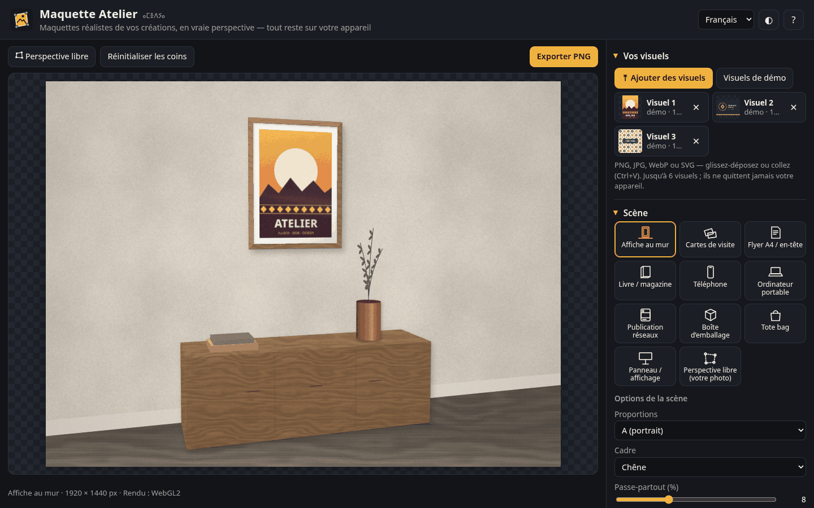

## Fonctionnalités

### Vos visuels
- **Ajouter**, **glisser-déposer** ou **coller** (Ctrl+V) jusqu’à **6 visuels** : PNG (avec transparence), JPG, WebP, SVG. Le `viewBox` des SVG est respecté et ils sont rendus à 3000 px de côté ; les images matricielles sont limitées à 4096 px.
- Trois **visuels de démo dessinés par le code** (affiche, carte de visite, motif inspiré des losanges kabyles). Ils sont remplacés dès que vous ajoutez les vôtres.
- **Plusieurs visuels par scène** : chaque face (recto / verso d’une carte, couverture / dos d’un livre, faces avant / côté / dessus d’une boîte, 2ᵉ flyer) a son **emplacement**, avec choix du visuel, de l’ajustement (remplir / contenir / étirer) et de la rotation. Sur les faces secondaires, la **couleur dominante** du visuel principal est utilisée par défaut.

### 11 scènes originales
| Scène | Options |
|---|---|
| **Affiche au mur** | proportions A (portrait / paysage), 2:3, 3:2, 3:4, 1:1 ; cadre aucun / noir / blanc / chêne / alu ; passe-partout ; mobilier (console, livres, vase) |
| **Cartes de visite** | paire ou pile, arrondi des coins, épaisseur |
| **Flyer A4 / en-tête** | A4, Letter, DL ; second feuillet ; crayon |
| **Livre / magazine** | debout ou à plat ; B5, A5, carré, magazine ; épaisseur ; texte du dos |
| **Téléphone** | debout ou à plat ; îlot caméra |
| **Ordinateur portable** | angle d’ouverture de l’écran (95–135°) |
| **Publication réseaux** | 1:1 ou 4:5, mode sombre, nom du compte |
| **Boîte d’emballage** | largeur / profondeur / hauteur ; mat, brillant ou kraft ; 3 faces visibles |
| **Tote bag** | couleur du tissu, taille de l’impression |
| **Panneau / affichage** | 4:3, 3:1 ou abribus (mupi) ; jour, crépuscule, nuit ; projecteurs |
| **Perspective libre** | votre photo de fond, papier, ombre |

### Perspective
- **Vraie perspective** : le visuel est projeté par **homographie** (projection 4 coins), et non par une simple déformation affine. Les lignes droites restent droites et les proportions respectent le point de fuite.
- **Rendu WebGL2** : homographie inverse calculée par pixel, mipmaps et filtrage anisotrope, antialiasing analytique des bords. Si WebGL est indisponible, un **rendu Canvas 2D** de secours prend le relais (subdivision en triangles). Dans les tests, les deux rendus diffèrent de moins de 0,1/255 en moyenne.
- **Caméra virtuelle** : cadrage (zoom), rotation horizontale et inclinaison. Chaque scène est un vrai petit modèle 3D en millimètres, et le cadrage s’adapte au format choisi (4:3, 3:2, 16:9, 1:1, 4:5, 9:16).
- **Perspective libre** (`F`) : faites glisser les **coins numérotés** à la souris ou au doigt. Au clavier, `[` `]` choisissent un coin, les flèches le déplacent (`Maj` = ×10) et `R` réinitialise.

### Rendu
- **8 thèmes de couleurs** (Lin, Atlas, Terracotta, Menthe, Nuit, Safran, Bois, Béton) ou couleurs personnalisées.
- **Fond** : celui de la scène, uni, dégradé (angle réglable) ou **transparent**.
- **Matières générées** (sans images, raccords invisibles) : uni, bois, béton, lin, plâtre, brique, terrazzo.
- **Lumière** : direction, intensité, **ombres portées** (contact + douceur), **brillance**, encre en **produit** (multiply) pour un rendu « imprimé », **texture papier**, **grain**, **vignettage**, ombres décoratives de **feuillage** ou de **store**.

### Exports et partage
- **PNG** de 1280 à **3840 px** (4K), avec **fond transparent** en option, et **JPG** (qualité réglable).
- **Réglages** en JSON (export / import), sans aucune donnée d’image.
- **Lien partageable** : la scène, les options, les réglages et les coins déplacés sont stockés dans l’adresse (`#sc=box&…`), jamais les images.
- Thème clair / sombre, mise en page responsive (bureau et mobile ~390 px), libellés ARIA, aide (`F1`).

## Utilisation
1. Ouvrez la [démo](https://salimadour31-boop.github.io/maquette-atelier/), ou `index.html` en local (aucun serveur nécessaire).
2. **Ajoutez** vos visuels (bouton, glisser-déposer ou Ctrl+V).
3. Choisissez une **scène**, réglez ses options et attribuez un visuel à chaque **emplacement**.
4. Ajustez la **vue** (cadrage, rotation, inclinaison), le **thème**, le **fond** et la **lumière**.
5. Au besoin, passez en **perspective libre** pour placer précisément les coins (par exemple sur votre propre photo).
6. **Exportez** en PNG (jusqu’à 4K, transparent si besoin) ou en JPG.

## Captures
| Cartes de visite | Livre |
|---|---|
| 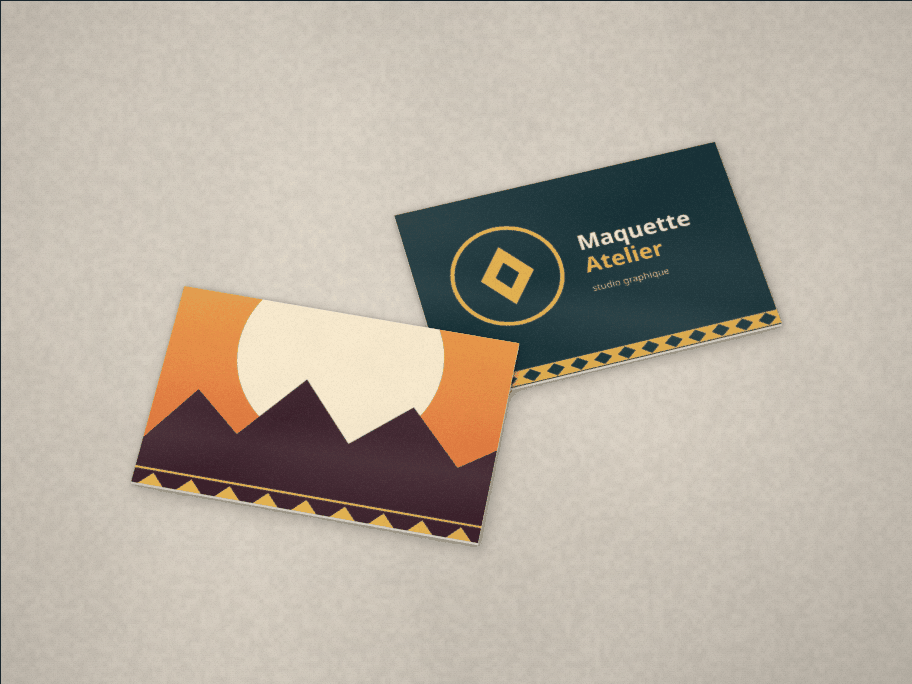 | 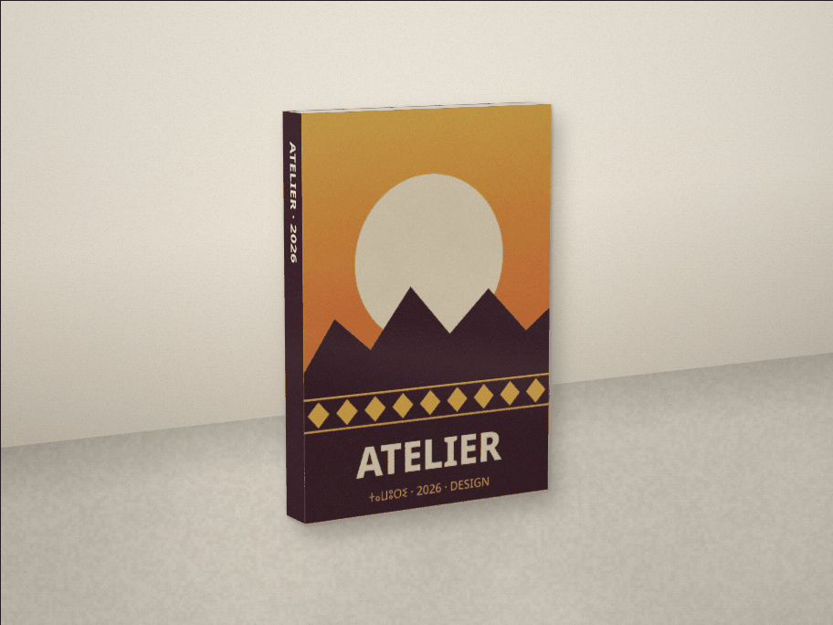 |
| **Boîte d’emballage (3 faces)** | **Téléphone** |
| 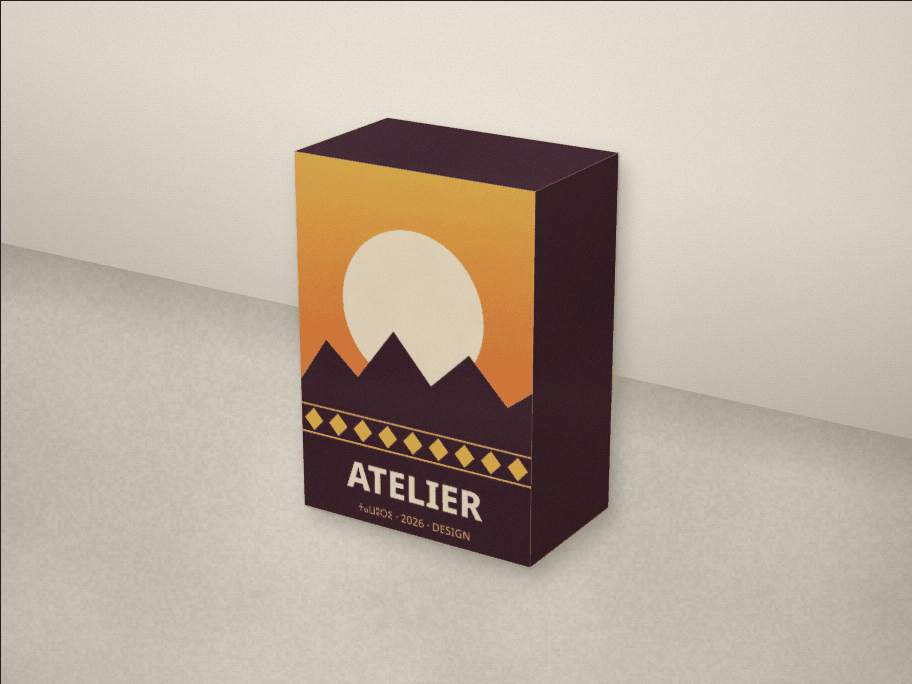 | 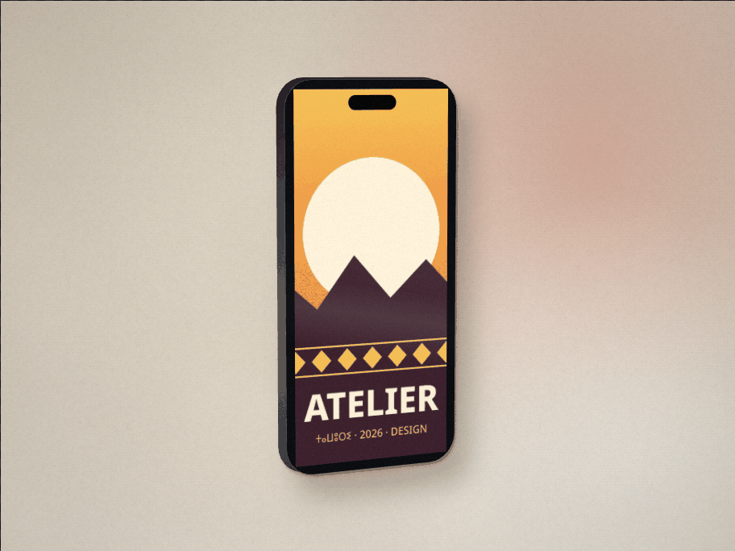 |
| **Ordinateur portable** | **Flyer A4 + crayon, ombre de feuillage** |
| 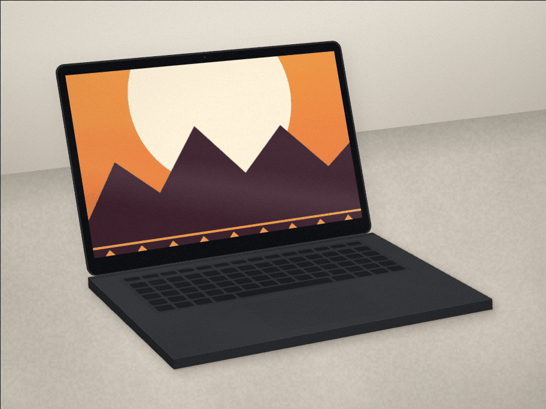 | 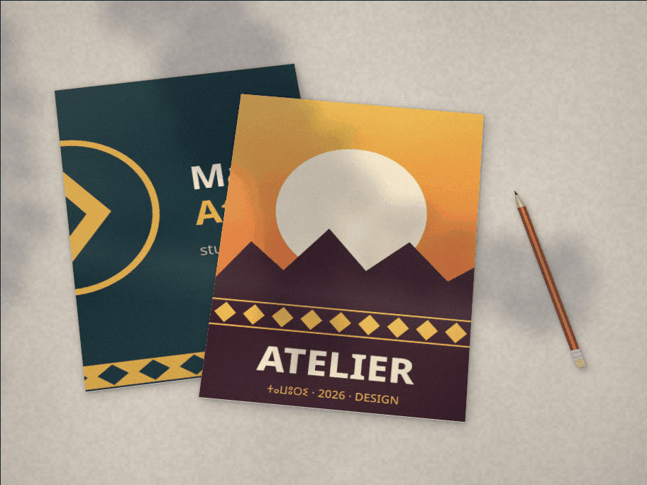 |
| **Panneau la nuit** | **Tote bag** |
| 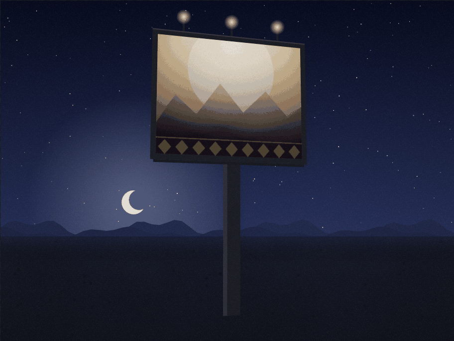 | 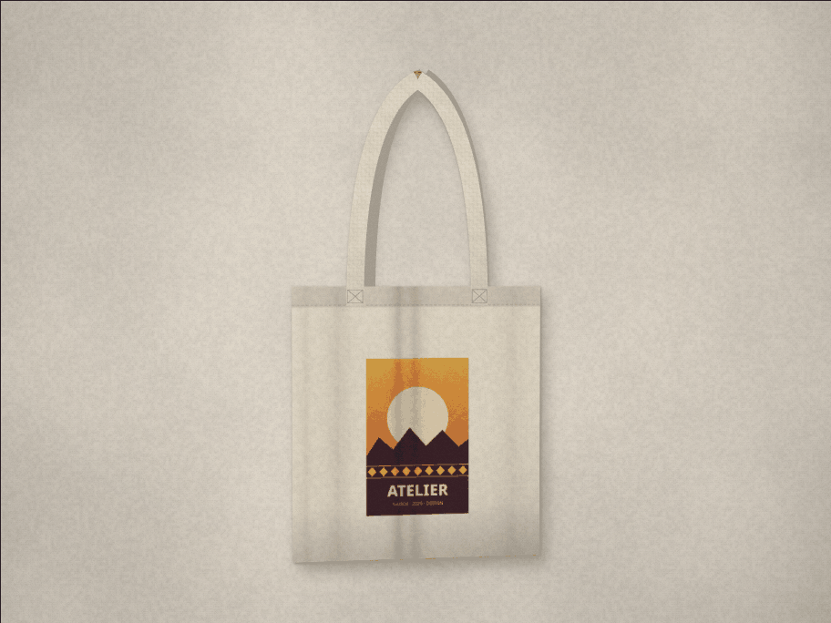 |
| **Publication réseaux** | **Affiche encadrée** |
| 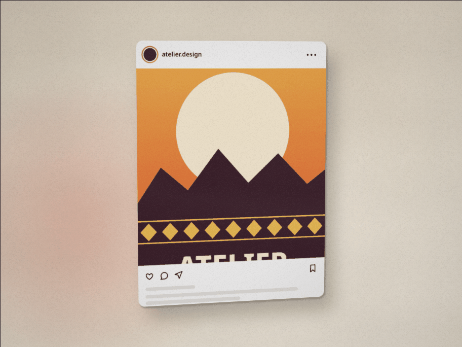 | 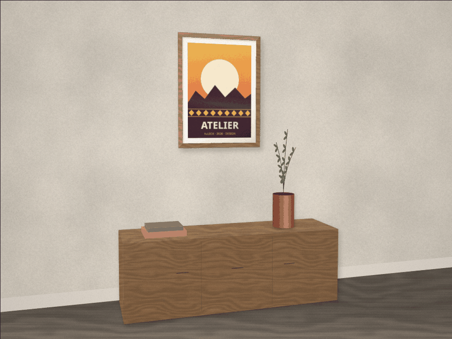 |
| **Perspective libre (coins déplacés)** | **Interface en tifinagh** |
| 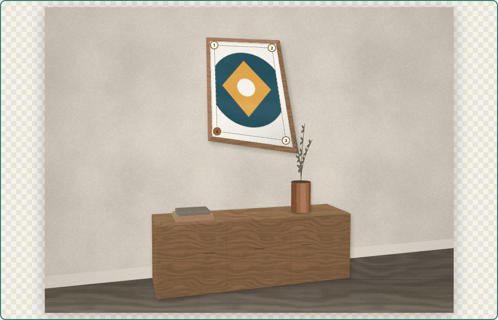 | 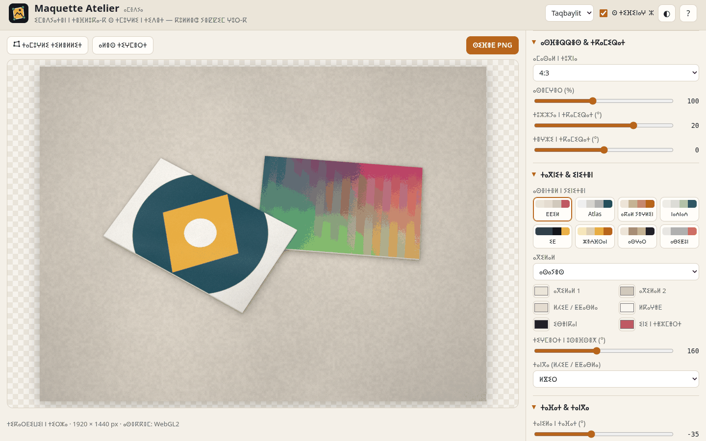 |

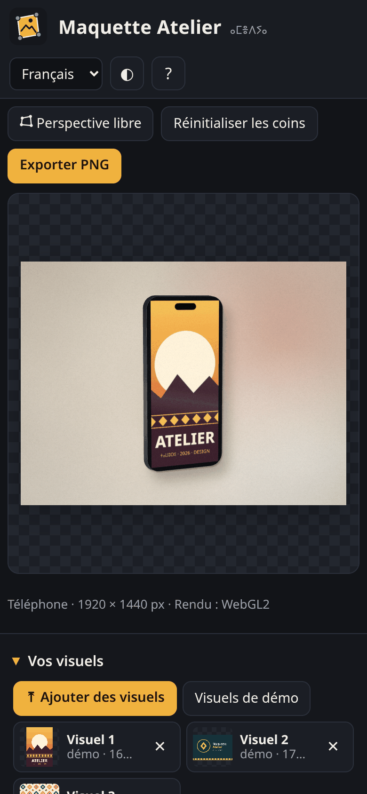

## Fonctionnement
- `js/warp.js` contient l’homographie carré → quadrilatère (Heckbert) et son inverse, le rendu WebGL2 et le rendu Canvas 2D par triangles.
- `js/scenes.js` décrit la caméra sténopé (axe Z vers le haut) et les 11 scènes. Les sommets 3D projetés deviennent les poignées déplaçables.
- `js/render.js` dessine dans l’ordre : environnement, ombres (passes de contact et douces décalées à l’opposé de la lumière), faces texturées, éclairage selon la normale de chaque face, brillance, puis finitions (vignettage, grain, ombres décoratives en `source-atop` pour garder la transparence).
- `js/textures.js` produit des matières raccordables (bruit de valeur périodique, fBm, générateur pseudo-aléatoire initialisé).
- `js/settings.js` valide les réglages et gère le lien partageable ; `js/i18n.js` contient les traductions et la translittération en tifinagh.

Pas de dépendance, pas de CDN, pas d’étape de compilation : HTML, CSS et JavaScript simples.

## Tests
- `node tests/geometry.test.js` lance 12 groupes de vérifications sans dépendance : homographie et inverse, lignes droites, accord exact avec la projection de la caméra, convexité, validation des réglages, aller-retour du lien, et toutes les scènes × toutes les options × caméras extrêmes.
- `node tests/ui.test.js` lance 36 vérifications Playwright à 1440 × 900 et 390 × 844. Elles couvrent le chargement PNG / JPG / SVG / glisser-déposer / coller, chaque scène et ses options, le déplacement des coins à la souris et au clavier, les thèmes, les langues, l’export PNG 4K (taille vérifiée), la transparence, le JPG, le JSON, la restauration par lien, la comparaison WebGL / Canvas 2D et l’absence d’erreurs dans la console. Ce test produit les captures.

## Confidentialité
Les visuels sont décodés et rendus localement (Canvas, WebGL). Aucune requête réseau, aucun cookie, aucune statistique. Seuls la langue, l’option tifinagh et le thème clair / sombre sont gardés dans `localStorage`.

---

## English

**Maquette Atelier** is a free, open-source **mockup generator** that runs entirely in your browser. Nothing is uploaded.

- **Designs**: add, drag-and-drop or paste up to 6 PNG (alpha), JPG, WebP or SVG designs. Three procedurally drawn demo designs are included.
- **11 original, procedurally rendered scenes (no stock photos)**: framed wall poster, business-card pair or stack, A4/Letter/DL flyer with pencil, book/magazine with spine, phone, laptop, social post (1:1 / 4:5, dark mode), packaging box with 3 printable faces, tote bag, billboard / mupi (day, dusk, night), and **free perspective** on your own photo.
- **True perspective**: designs are mapped through a **homography**. The renderer is WebGL2 (per-pixel inverse homography, mipmaps, anisotropic filtering, analytic edge anti-aliasing), with a Canvas-2D triangle-subdivision fallback (`?gl=0`). Each scene is a small 3D model seen through a virtual camera (zoom, yaw, pitch). The projected corners become **draggable handles**, usable with mouse, touch or keyboard (`F`, `[` `]`, arrows, `R`).
- **Multiple designs per scene**: each face is a slot with its own design, fit and rotation.
- **Look**: 8 colour themes or custom colours; scene / solid / gradient / transparent background; seamless procedural materials (wood, concrete, linen, plaster, brick, terrazzo); light direction and strength, soft contact shadows, gloss, multiply ink, paper texture, grain, vignette, leaf or blind shadows.
- **Export**: PNG up to **3840 px (4K)** with optional **transparent background**, JPG, settings JSON (export / import), and a **shareable link** that stores settings and moved corners, never images.
- French (default), English, Taqbaylit (+ optional Tifinagh); light / dark; responsive; ARIA labels.

**Privacy**: everything is processed locally. There are no network requests, cookies or analytics.

**Tests**: `node tests/geometry.test.js` (maths, settings, every scene × option × camera) and `node tests/ui.test.js` (36 Playwright checks at 1440 × 900 and 390 × 844, including the 4K export size, transparency, WebGL vs Canvas-2D agreement and no console errors).

## Licence
[MIT](LICENSE) © 2026 Amirouche Amwanes. Police Noto Sans Tifinagh : SIL Open Font License 1.1 (`fonts/OFL-NotoSansTifinagh.txt`). Toutes les scènes, matières, icônes et images de démo ou de test ont été créées par le code du projet.
